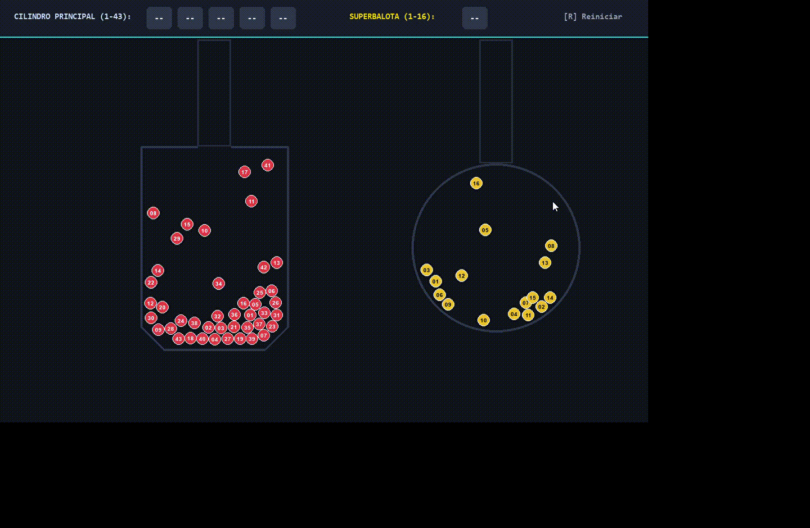

# 🎰 Simulador de Baloto Colombia

Simulación física interactiva de tómbola y balotas desarrollada en Python usando Pygame y Pymunk.



## 🚀 Requisitos e Instalación

Para ejecutar este simulador en tu computadora:

1. Asegúrate de tener **Python** instalado.
2. Instala las dependencias ejecutando en tu terminal:
   ```bash
   pip install pygame pymunk
